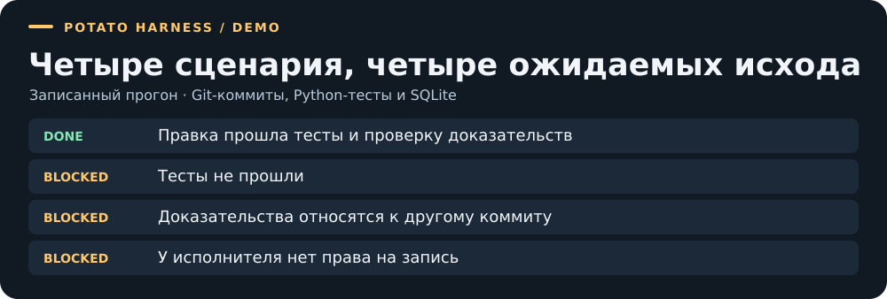
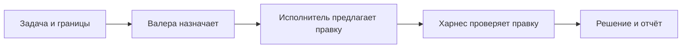

# Potato Harness

**Харнес для AI-агентов, который проверяет правки по тестам и конкретному Git-коммиту.**

[](https://github.com/two-potato/potato_harness/actions/workflows/validate.yml)
[](LICENSE)

[Быстрый старт](#быстрый-старт) · [Видеоразбор](docs/demo/walkthrough.mp4) · [Инженерный кейс](docs/PORTFOLIO.md) · [Испытания с моделью](docs/trials/2026-11-06-RUNBOOK.md)

Агент предлагает правку. Харнес ограничивает область изменений, запускает проверки и сохраняет результат вместе с доказательствами. Если тесты упали, доказательства относятся к другому коммиту или у исполнителя нет права на запись, задача блокируется.

[](docs/demo/report.json)

## Быстрый старт

Нужны Python 3.12+ и Git. При первом запуске скрипт устанавливает зависимости в локальное окружение.

```bash
git clone https://github.com/two-potato/potato_harness.git
cd potato_harness
python3 tools/run_demo.py
```

Откройте HTML-отчёт по пути из вывода команды. Демо использует детерминированного исполнителя, реальные Git-коммиты, Python-тесты и SQLite. API-ключ не нужен. [Записанный прогон](docs/demo/terminal.txt) · [Отчёт JSON](docs/demo/report.json)

### Локальная разработка без Bubblewrap

```bash
python3 -m harness.readiness --mode development
```

Для исполнения тестов AI-изменённого проекта нужна проверенная изоляция:
`python3 -m harness.readiness --mode execution`. Подробнее:
[Локальная разработка и изоляция](docs/runtime/LOCAL_DEVELOPMENT.md).

## Как устроен рантайм



| Компонент | За что отвечает |
| --- | --- |
| **Валера и OpenCode / OMO** | Координатор назначает исполнителя. Отдельная сессия возвращает предложение правки. |
| **Харнес** | Контролирует права, бюджет и состояние задачи. Проверяет точную ревизию, запускает тесты в Bubblewrap и сохраняет доказательства. Неопределённый внешний вызов остаётся в журнале для сверки. |
| **Jev** | Даёт предварительную рекомендацию и, если включено, проверяет результат перед приёмкой. |
| **HALO** | Оценивает изменения контекста на раздельных наборах трасс. Результат оценки сохраняется как предложение. |
| **Профиль marketplace** | Добавляет проверки каталога, прав продавцов и покупателей, цен, резервов, заказов и возвратов. Бизнес-правила задаёт проект. |

## Что проверено

| Сценарий | Статус |
| --- | --- |
| Демо с четырьмя исходами | Воспроизводится без модели. CI проверяет демо, контракты и Python-тесты. |
| OpenCode 1.19.5 + OMO 5.1.60 | Проверены через локальный тестовый HTTP-провайдер. |
| Сквозной запуск с внешней моделью | Требует ключа, доступной модели и Linux-хоста с рабочим Bubblewrap. На машине разработки проверка изоляции заблокирована системой. |
| Границы runtime 0.2.0-trial | Одна задача LOW с заданными файлами и тестами. Параллельная работа команды и задачи повышенного риска требуют отдельных испытаний. |

Для испытаний на Linux выполните `python3 tools/prepare_trials.py --install --verify` и проверьте статус изоляции. Команды запуска, настройки Jev и проверка HALO описаны в [инструкции испытаний](docs/trials/2026-11-06-RUNBOOK.md). Результаты проверок собраны в [VALIDATION.md](VALIDATION.md).

## Документация

- [Рантайм и конфигурация задачи](docs/runtime/RUNTIME.md) · [OpenCode / OMO](integrations/opencode/README.md)
- [Контроллер](docs/runtime/STATE_CONTROLLER.md) · [Права](docs/runtime/BROKER.md) · [Изоляция](docs/runtime/ISOLATION.md) · [Бюджет и восстановление](docs/runtime/DURABLE_CORE.md)
- [Jev](docs/runtime/JEV.md) · [HALO](docs/runtime/HALO.md) · [Профиль marketplace](profiles/marketplace.md)
- [План развития](IMPLEMENTATION_PLAN.md) · [Как внести изменения](CONTRIBUTING.md)

Индивидуальный проект, разработанный с помощью AI. Код проекта распространяется по [MIT](LICENSE). Внешние зависимости сохраняют свои лицензии.
