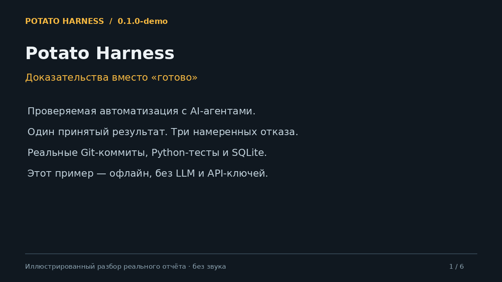

# Potato Harness

**Проверяемая AI-автоматизация: агент предлагает изменение, программа решает, можно ли принять результат.**

[](https://github.com/two-potato/potato_harness/actions/workflows/validate.yml)


**Портфольный preview `0.1.0-demo`.** Есть работающий локальный сценарий, контроллер
SQLite и проверка доказательств/разрешений. Это ещё не production sandbox и не
универсальная автономная команда разработчиков.



[Двухминутный разбор](docs/demo/walkthrough.mp4) ·
[Результаты записанного запуска](docs/demo/terminal.txt) ·
[Кейс и ограничения](docs/PORTFOLIO.md) ·
[Архитектура и роли](docs/PROJECT_OVERVIEW.md)

## Попробовать за несколько минут

Нужны **Python 3.12+ и Git**. После клонирования:

```bash
git clone https://github.com/two-potato/potato_harness.git
cd potato_harness
python3 tools/run_demo.py
```

Первый запуск создаёт `.venv-demo` и устанавливает зафиксированные зависимости
(нужен интернет для пакетов). Следующие запуски работают без сети. Путь к HTML-отчёту
появится в терминале — откройте `index.html` браузером. Также сохраняются JSON с
доказательствами, журнал и `.cast` для воспроизведения терминального вывода.
Новый каталог создаётся для каждого запуска; существующие отчёты не перезаписываются.

Проверено на Linux. На Windows используйте WSL с Python 3.12+ и Git; нативный Windows пока не проверен. Базовый режим не требует
API-ключей и **не использует LLM**: предложения детерминированы, Git, тесты и SQLite настоящие.

## Что демонстрирует проект

| Сценарий | Ожидаемый результат | Причина |
| --- | --- | --- |
| Исправление расчёта суммы | `DONE` | Тесты и проверка артефакта относятся к актуальному коммиту |
| Неверное исправление | `BLOCKED` | Реальные тесты не прошли |
| Отчёт от старого коммита | `BLOCKED` | Доказательства не соответствуют текущей версии |
| Запись от роли без разрешения | `BLOCKED` | Координатор не может изменять код |

Исполнитель выбирает только разрешённую операцию в маленьком тестовом проекте.
Произвольный код модели не запускается. Верификатор связывает доказательства
с задачей, её ревизией, репозиторием, коммитом, политикой и SHA-256 артефакта.

## Подключить настоящую модель

Если Ollama уже работает локально и нужная модель установлена:

```bash
python3 tools/run_demo.py --adapter ollama --model qwen2.5-coder:14b
```

Модель предлагает строго ограниченный JSON; контроллер не доверяет её заявлению
об успехе. Нужную модель выбираете вы, автоматической загрузки нет.
[Протокол и ограничения адаптера](docs/runtime/OLLAMA.md).
Записанный пример работает офлайн; live-вызов модели в этой среде не проверялся.

## Что реализовано

- Контроллер состояний: атомарный журнал, CAS, возобновление и фиксация коммита.
- Проверка аттестаций, байтов артефакта, покрытия требований и противоречивых результатов.
- Проверка привязки разрешения к операции, срока действия и отзыва через доверенный источник.
- Ограниченный демонстрационный исполнитель и опциональный адаптер Ollama.
- Автоматические тесты, включая два процесса, откат транзакций и локальный HTTP-сервер.
- Исходная спецификация: 9 ролей, 10 навыков, 14 схем и план развития.

Общий брокер инструментов, OS sandbox, планировщик, восстановление внешних эффектов,
настоящий сервис выдачи разрешений, OpenCode/Jev и production activation **не реализованы**.
Наличие метода проверки разрешения не означает наличие такого сервиса.

## Проверить разработку

```bash
python -m pip install -r requirements-validation.txt
python -m unittest discover -s tests -v
python tools/validate_pack.py
python tools/verify_manifest.py
python -m harness.demo
```

| Документ | Содержимое |
| --- | --- |
| [Кейс](docs/PORTFOLIO.md) | Задача, решения, измерения и честные ограничения |
| [Контроллер](docs/runtime/STATE_CONTROLLER.md) | API и границы доверия |
| [Верификатор](docs/runtime/VERIFIER.md) | Контракты аттестаций и разрешений |
| [План](IMPLEMENTATION_PLAN.md) | Следующие этапы runtime |
| [Валидация](VALIDATION.md) | Выполненные проверки |
| [Contributing](CONTRIBUTING.md) | Как воспроизвести проверки и предложить изменения |
| [Changelog](CHANGELOG.md) | Версии демонстрационного проекта |

Индивидуальный проект, разработанный с помощью AI. Контракты имеют версию `3.0.1`;
версия демонстрации хранится отдельно в `DEMO_VERSION`. Лицензия — [MIT](LICENSE).

## HALO и Jev

- **Jev:** исполняемые предварительный и итоговый advisory hooks, журнал попыток,
  защита от повторной отправки, System One API OpenCode/TypeSafe. Без ключа
  предварительный вызов фиксирует UNAVAILABLE. [Настройка](docs/runtime/JEV.md).
- **HALO:** офлайн-предложения оптимизации контекста, отдельная оценка, контроль
  использования holdout и сохранённые метрики. Самостоятельного применения нет.
  [Архитектура и ограничения](docs/runtime/HALO.md).

```bash
python -m harness.halo --output .runtime/new-halo-report
python3 tools/run_demo.py --jev-provider opencode --jev-model jev-1.13-free --jev-completion
```

Второй запуск требует OPENCODE_API_KEY в окружении. Live Jev пока не проверен;
полный production-профиль v3.3 и интеграция с сессией OpenCode ещё не активированы.
