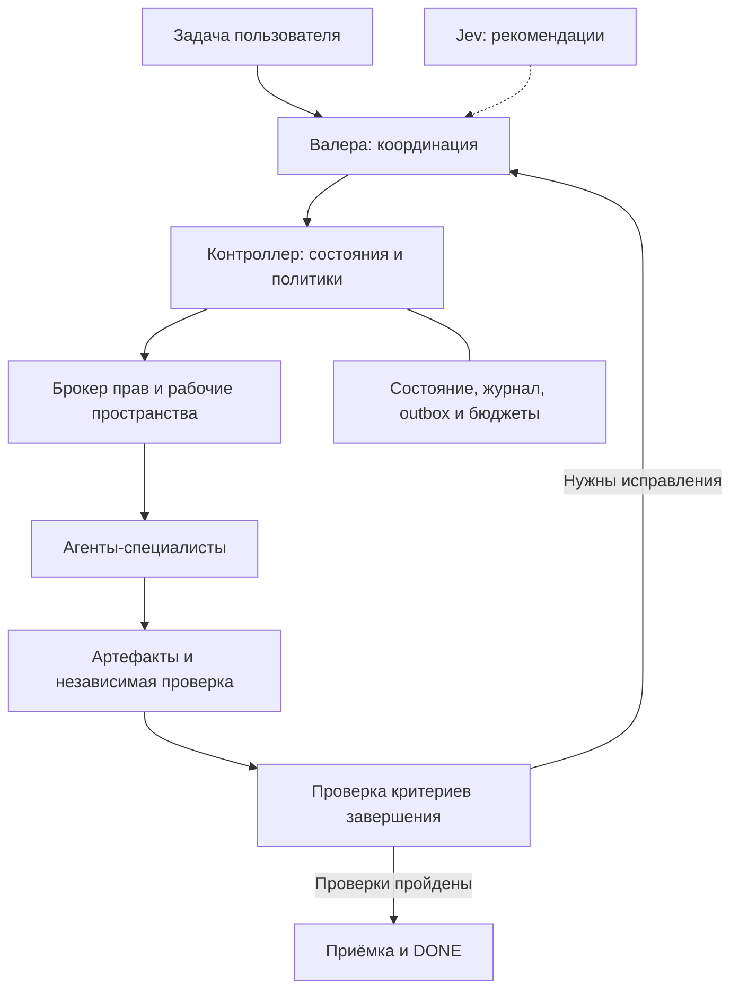

# Potato Harness

**Управляемая разработка с AI-агентами: делегирование, проверяемые результаты и явные границы полномочий.**

Potato Harness — проект системы, в которой агент-координатор ставит задачи специалистам, а программные механизмы контролируют права, состояние задач, бюджеты и доказательства выполнения. Цель — сделать работу команды агентов воспроизводимой и проверяемой.

> **Статус: спецификация и контракты, версия `3.0.1-spec`.**
> В репозитории есть инструкции агентов, навыки, политики, схемы данных, SQL и исполняемые статические тесты. Контроллер, брокер прав, OS sandbox и интеграции OpenCode/Jev ещё не реализованы. Команды ниже проверяют пакет; они не запускают агентную систему.

## Для чего проект

- Разделять управление задачами и инженерное исполнение.
- Не принимать агентское «готово» без проверяемых артефактов.
- Привязывать проверки к конкретному коммиту и версии задачи.
- Ограничивать доступ к файлам, инструментам, сети и внешним действиям.
- Предотвращать конфликтующие изменения и неконтролируемые повторы после сбоев.
- Измерять качество, стоимость и задержки перед изменением правил работы агентов.

Проект независим от конкретного приложения. OpenCode рассматривается как целевая среда интеграции; его реальный SDK и формат конфигурации должны быть проверены при реализации адаптера. OMO — необязательная интеграция, отключённая до проверки совместимости.

## Как устроен Potato Harness



Схема показывает **целевую архитектуру**, а не уже работающие компоненты.

**Валера** — единственный агент-координатор. Он определяет цель, исполнителей, критерии приёмки и сравнивает структурированные результаты. Сам не читает исходники, не пишет код, не запускает shell, Git или тесты и не выполняет деплой.

**Jev** даёт рекомендации перед делегированием и, в соответствующем профиле, при завершении. Он не выдаёт права, не отменяет обязательные проверки и не присваивает DONE.

**Детерминированный контроллер** должен обеспечивать правила программно. Инструкции и JSON Schema сами по себе не являются защитой инструментов или операционной системы.

## Команда агентов

| Агент | Ответственность |
| --- | --- |
| Valera CEO | Постановка задач, делегирование, координация и логическая приёмка |
| Architect | Архитектура, границы компонентов и контракты |
| Backend | Серверная логика, API, данные и миграции |
| Frontend | Интерфейсы, состояния UI и доступность |
| Search | Поиск, индексация, релевантность и свежесть индекса |
| ML & Recommendations | Рекомендации, события, атрибуция и оценка качества |
| QA | Независимая проверка поведения и критериев приёмки |
| DevOps & SRE | Доставка, инфраструктура, наблюдаемость и восстановление |
| Security | Права, секреты, границы доверия и опасные операции |

Исходные файлы девяти ролей сохранены без изменения текста; контрольные суммы находятся в [sources.json](sources.json). Explore — опциональная возможность исследования с доступом только на чтение, а не обязательный дополнительный специалист.

## Что уже есть и что предстоит сделать

| Часть | Состояние |
| --- | --- |
| 13 разделов спецификации | Подготовлены |
| 9 файлов ролей и общие правила | Подготовлены |
| 10 проектных навыков | Подготовлены; подключение зависит от runtime |
| 14 JSON Schema и примеры данных | Структурно проверены |
| Начальная SQLite-миграция | Проверена на создание таблиц и целостность |
| 30 статических и контрактных тестов | Проходят локально |
| GitHub Actions workflow | Включён в репозиторий; результат каждого запуска смотрите в Actions |
| Контроллер, планировщик, брокер, сборщики evidence | Требуют реализации |
| OpenCode/Jev adapters и OS sandbox | Требуют реализации и проверки |
| Runtime-сценарии H/M/C | Описаны; `NOT_RUN` |

Подробности и границы проверки — в [VALIDATION.md](VALIDATION.md). Подлинность CI-результата или подтверждения человека нельзя установить одной проверкой JSON: для этого нужны доверенные адаптеры.

## Быстрая проверка пакета

Нужны Git, Python **3.12** и доступ к пакетам Python. Для Linux/macOS:

```bash
git clone https://github.com/two-potato/potato_harness.git
cd potato_harness
python3 -m venv .venv
source .venv/bin/activate
python -m pip install -r requirements-validation.txt
python tools/validate_pack.py
python -m unittest discover -s tests -v
python tools/verify_manifest.py
```

Для Windows PowerShell активируйте окружение командой `.venv\Scripts\Activate.ps1`.

Проверки охватывают схемы и fixtures, хеши исходных ролей, структуру навыков, SQL, некорректные состояния и данные, уникальность ключей outbox и согласованность политик. **Они не проверяют живую работу агентов, изоляцию процессов или реальные внешние эффекты.**

`MANIFEST.sha256.json` фиксирует снимок содержимого репозитория. После намеренного изменения перечисленных файлов обновите manifest после ревью; проверка хешей не заменяет проверку корректности.

## Навигация

| Путь | Содержимое |
| --- | --- |
| [AGENTS.md](AGENTS.md) | Общие инструкции для работы с проектом |
| [agents/](agents/) | Валера и восемь специалистов |
| [skills/INDEX.md](skills/INDEX.md) | Каталог навыков и соответствие ролям |
| [rules/](rules/) | Приоритеты, безопасность и формат отчётов |
| [policy/](policy/) | Проверки, переходы состояний и профили версий |
| [schemas/](schemas/) | JSON Schema 2020-12 для задач и артефактов |
| [fixtures/valid/](fixtures/valid/) | Синтетические структурно корректные примеры |
| [state/001_init.sql](state/001_init.sql) | Начальная схема хранения |
| [docs/harness/v3/](docs/harness/v3/) | Архитектура и подробные правила |
| [evals/cases.json](evals/cases.json) | 42 сценария проверки будущего runtime |
| [tests/](tests/) и [tools/](tools/) | Исполняемые статические проверки |
| [adapters/README.md](adapters/README.md) | Контракт подключения целевой среды |
| [IMPLEMENTATION_PLAN.md](IMPLEMENTATION_PLAN.md) | План реализации по этапам |

## Проектные навыки

Делегирование, исследование, реализация, проектирование контрактов, независимая проверка, security review, восстановление, перенос, HALO-предложения и выбор проверок по предметной области.

Навыки загружаются по задаче и роли. Они не расширяют права и не отменяют проверки. Для Валеры содержимое передаёт runtime: доступ к чтению исходников для загрузки навыка ему не предоставляется.

## Принципы

1. **Доказательства вместо заявлений.** Результат привязан к задаче, её версии, коммиту и проверяемому артефакту.
2. **Права выдаёт программа.** Агент не может выдать себе доступ или изменить обязательную политику.
3. **Независимая проверка по риску.** Автор не подменяет обязательного независимого проверяющего.
4. **Ограниченные попытки.** Бюджеты и остановка при отсутствии прогресса предотвращают бесконечные циклы.
5. **Неопределённый эффект сначала сверяется.** Сбой после внешнего действия не означает, что действие можно повторить.
6. **Опасные действия требуют человека.** Подтверждение относится к конкретной операции, области и версии задачи.
7. **Улучшения через review.** HALO предлагает изменения на основе измерений; автоматического изменения правил и merge нет.

## План развития

| Профиль | Целевой объём |
| --- | --- |
| v3.0 core | Состояния/CAS, контекст, broker/sandbox, leases, evidence/approval, preflight, outbox, базовое восстановление и бюджеты |
| v3.1 | Сохраняемый completion audit с Jev |
| v3.2 | Расширенные handoff/replay, длительные и нагрузочные проверки |
| v3.3 | HALO-предложения с независимой оценкой и отдельным holdout |

Это план, а не перечень выпущенных runtime-функций. Формат контрактов сейчас имеет версию `3.0.1`; версия спецификации — `3.0.1-spec`.

Начинать реализацию следует с [плана](IMPLEMENTATION_PLAN.md): контроллер, доверенные проверки, брокер и изоляция, leases, восстановление и бюджет, затем контекст и адаптеры. Активация допустима только после проверки реализованных компонентов в изолированной среде.

## Работа с изменениями

Перед изменениями прочитайте [AGENTS.md](AGENTS.md). Держите PR небольшими, указывайте критерии приёмки, фактически выполненные проверки и ограничения. Изменения политик должны сохранять согласованность документации, схем и тестов. Не редактируйте исходные role snapshots без отдельного решения об обновлении источников.

Ссылки на исходные документы Notion сохранены для происхождения пакета. Доступ к ним может быть ограничен; для чтения спецификации и локальных проверок достаточно файлов этого репозитория.
