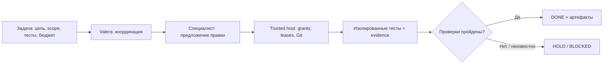
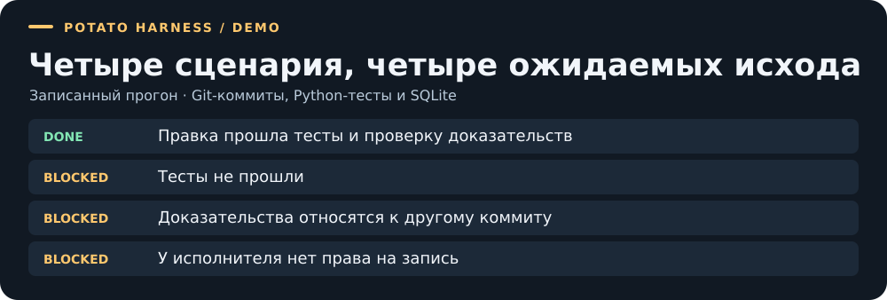

# Potato Harness

**Local-first harness для разработки ПО с AI-агентами: модель предлагает изменения, доверенный runtime решает, можно ли их принять.**

[](https://github.com/two-potato/potato_harness/actions/workflows/validate.yml)
[](LICENSE)

> **Статус: экспериментальный проект, не production-ready.** Работают детерминированное демо и ограниченный `0.2.0-trial` runtime. Полный сквозной запуск с внешней моделью и реальной Linux-изоляцией пока не подтверждён.

[Запустить демо](#быстрый-запуск) · [Как устроен проект](#архитектура) · [Реальные проверки](#что-проверено) · [Ограничения](#что-пока-не-готово) · [Что хочется обсудить](#хочу-критическое-ревью)

## Зачем это нужно

Обычный coding-agent может сообщить «готово», даже если тесты упали, изменены лишние файлы или отчёт относится не к тому коммиту. Его слова не должны быть основанием для merge, деплоя или следующего действия.

**Potato Harness пытается отделить предложения AI от полномочий на выполнение и приёмку.** Он хранит состояние задачи, ограничивает область изменений, проверяет реальные тестовые результаты и привязывает evidence к конкретной Git-ревизии. При неизвестном исходе внешнего вызова или недоступной изоляции система останавливается, а не продолжает «на доверии».

Это **не ещё один AI-агент, чат-обёртка или замена OpenCode**. Это управляющий и проверяющий слой вокруг подключаемых исполнителей. Конечная цель — использовать его локально с разными моделями и типами программных проектов, не привязывая ядро к одному стеку.

## Как это работает



- **Valera** — один координатор: формулирует назначение и контролирует процесс, но не читает исходники, не пишет код и не запускает shell/Git/тесты.
- **Восемь специалистов** — `architect`, `backend`, `frontend`, `search`, `ml-recommendations`, `qa`, `devops-sre`, `security`. Их роли и контракты описаны; полноценный параллельный командный runtime ещё не реализован.
- **Trusted host** — детерминированный Python-код, а не модель. Он управляет SQLite-состояниями, правами, бюджетами, арендой ресурсов, внешними эффектами, публикацией артефактов и evidence gates.
- **OpenCode + OMO** — текущий проверенный модельный gateway с отдельными сессиями координатора и специалиста. Модель не получает нативные shell, filesystem или MCP-инструменты.
- **Jev** — необязательный консультативный preflight/completion review; не может выдать права или самостоятельно принять работу.
- **HALO** — offline-оценка предложений по оптимизации контекста на раздельных наборах трасс; изменений без утверждения не применяет.

Главный принцип: **«агент сказал PASS» не равно «система разрешила DONE».**

## Быстрый запуск

Нужны **Python 3.12+** и **Git**. При первом запуске для установки Python-зависимостей понадобится интернет. API-ключ модели не нужен.

```bash
git clone https://github.com/two-potato/potato_harness.git
cd potato_harness
python3 tools/run_demo.py
```

Скрипт создаст локальное окружение, запустит демонстрационный прогон и сообщит путь к HTML-отчёту. В демо используются **реальные локальные Git-коммиты, Python-тесты и SQLite**, но исполнитель детерминированный, **не внешняя LLM**.

Ожидаемые четыре сценария:

| Сценарий | Результат |
| --- | --- |
| Исправление в разрешённой области, тесты прошли | `DONE` |
| Тесты не прошли | `BLOCKED` |
| Evidence относится к устаревшей ревизии | `BLOCKED` |
| Исполнитель не имеет права на изменение | `BLOCKED` |

[Описание демо и материалы](docs/PORTFOLIO.md) · [Записанный отчёт JSON](docs/demo/report.json) · [Короткое видео](docs/demo/walkthrough.mp4)



Для проверки самого проекта без запуска недоверенного кода:

```bash
python3 -m harness.readiness --mode development
python3 -m unittest discover -s tests -v
python3 tools/validate_pack.py
python3 tools/verify_manifest.py
```

`development: ready` означает наличие предпосылок для разработки, **не** разрешение выполнять AI-сгенерированный код.

## Что проверено

Состояние репозитория `main` на коммите [`ab8b736`](https://github.com/two-potato/potato_harness/commit/ab8b736640116ed921c3f41e13beb2f103aa8ded), CI от **12 ноября 2026 года**:

| Уровень | Подтверждение | Граница подтверждения |
| --- | --- | --- |
| Python runtime и контракты | **206 тестов: 201 passed, 5 skipped** | Пропущены пять live-тестов Bubblewrap: на GitHub runner нет `bwrap` |
| Детерминированное демо | **4/4 ожидаемых исхода** | Без внешней модели и без доказанной OS-изоляции |
| OpenCode 1.19.5 + OMO 5.1.60 | **7 тестов** и smoke через реальный SDK/плагин | Четыре запроса к **локальному тестовому HTTP-провайдеру**, не live inference |
| Marketplace Blueprint R1 | **14 контрактных + 7 entrypoint-тестов** | Проверка схем и создание контрактного seed, не работающий marketplace |
| Git / SQLite / evidence | Реальные коммиты, транзакционные и негативные тесты | Проверенный ограниченный сценарий, не универсальная production-приёмка |

[Основной GitHub Actions прогон](https://github.com/two-potato/potato_harness/actions/runs/43167323426) · [Marketplace CI](https://github.com/two-potato/potato_harness/actions/runs/43167323539) · [Подробные результаты и исторические снимки](VALIDATION.md)

## Что пока не готово

Это важнее бейджей:

1. **Нет подтверждённого end-to-end прогона с внешней моделью в защищённом окружении.** OpenCode/OMO проверены через локальный fixture; качество настоящего AI-исполнителя этим не доказано.
2. **Linux sandbox ещё не прошёл live containment-тесты.** Bubblewrap-адаптер работает по принципу fail-closed: если изоляция недоступна, runtime не выполняет тесты напрямую на хосте. Но сам факт наличия адаптера не равен сертифицированной изоляции.
3. **`0.2.0-trial` рассчитан на одну заранее ограниченную задачу `LOW/BOUNDED`.** Scope содержит существующие конкретные файлы, а команда тестов задаётся доверенным оператором. Полноценного распределения задач между восемью специалистами, параллельного multi-agent исполнения и независимой QA-приёмки пока нет.
4. **Бюджет не является гарантированным общим лимитом расходов у провайдера.** Есть резервирование и сверка usage, но цена дополнительных вызовов, в том числе Jev, и неизвестные результаты требуют отдельного контроля.
5. **Восстановление намеренно консервативно.** Неопределённый внешний эффект помечается `UNKNOWN` и не отправляется повторно автоматически. Полностью автоматическое безопасное продолжение после произвольного сбоя — ещё задача разработки.
6. **Редактирование секретов в контексте не является полноценной DLP-защитой.** Шаблоны скрывают типичные ключи, но сами по себе не гарантируют, что в запрос к внешней модели не попадёт чувствительный фрагмент исходников.
7. **HALO пока оценивает ограниченные изменения по детерминированным метрикам.** Уменьшение объёма текста не следует путать с доказанным улучшением качества модели.

Для пробного запуска с реальной моделью нужны доступная модель/ключ и **Linux-хост с работающим Bubblewrap**. Начать следует с:

```bash
python3 tools/prepare_trials.py --install --verify
python3 -m harness.readiness --mode execution
python3 -m harness.isolation --probe
```

Если проверка изоляции не прошла, **не обходите её**. Дальнейшие команды, формат ограниченной задачи и ожидаемые исходы: [runbook испытаний](docs/trials/2026-11-06-RUNBOOK.md) и [документация runtime](docs/runtime/RUNTIME.md).

## Архитектура

Ядро предполагается **local-first**, **model-agnostic** и **project-agnostic**. Сейчас Python + SQLite служат доверенной частью single-host сценария, а OpenCode/OMO — конкретной закреплённой реализацией gateway. Это не означает, что они должны навсегда стать обязательными для ядра.

| Слой | Код / контракты |
| --- | --- |
| Жизненный цикл и состояния | [`harness/controller/`](harness/controller/), [`policy/`](policy/), [`state/`](state/) |
| Права и ресурсы | [`harness/policy/`](harness/policy/), [`harness/leases/`](harness/leases/), [`harness/budget/`](harness/budget/) |
| Исполнение и изоляция | [`harness/runtime/`](harness/runtime/), [`harness/isolation/`](harness/isolation/), [`harness/publisher/`](harness/publisher/) |
| Контекст и задачи | [`harness/context/`](harness/context/), [`harness/scheduler/`](harness/scheduler/), [`agents/`](agents/) |
| Evidence и advisory | [`harness/verifier/`](harness/verifier/), [`harness/jev/`](harness/jev/), [`harness/halo/`](harness/halo/) |
| Подключаемый исполнитель | [`integrations/opencode/`](integrations/opencode/) |
| Доменные контракты | [`blueprints/marketplace/`](blueprints/marketplace/) и [`profiles/`](profiles/) |

JSON Schema описывает структуру данных, **но не выдаёт полномочий**. Решение о разрешении действия принимает trusted host на основании свежих grants, task revision и состояния ресурсов. Git-коммит и результаты проверок привязаны к evidence, а не берутся из ответа LLM.

Дополнительные детали: [управление и policy](docs/harness/v3/CONTROL_FLOW.md) · [изоляция](docs/runtime/ISOLATION.md) · [broker](docs/runtime/BROKER.md) · [OpenCode/OMO](integrations/opencode/README.md) · [план развития](IMPLEMENTATION_PLAN.md).

### Отдельно о Marketplace

В репозитории есть `blueprints/marketplace/`: контрактная заготовка для будущей фабрики маркетплейсов. Она проверяет R1-манифест и создаёт **отдельный Git-репозиторий с контрактами**, но пока не генерирует рабочие Django/Next.js-сервисы, инфраструктуру или платёжную интеграцию.

```bash
python3 -m pip install -r blueprints/marketplace/requirements-dev.txt
python3 tools/marketplace.py status
python3 tools/marketplace.py init demo-market-kz
```

Это пример возможного доменного профиля, **не причина менять универсальное ядро под маркетплейс**. [Подробности R1 и план R2–R5](blueprints/marketplace/README.md).

## Что дальше

Ближайший приоритет — не новые роли и не красивые графы, а проверяемый рабочий контур:

1. Запустить и зафиксировать **live sandbox/security-тесты** на подходящем Linux-хосте; усилить ограничения model gateway.
2. Получить **реальный AI end-to-end прогон** с проверяемыми артефактами и отказами на ошибках.
3. Прогнать **fault-injection** для outbox, бюджета, leases и частичных публикаций.
4. Затем расширить single-task runtime до **DAG/multi-agent orchestration**, независимого review и подключаемых адаптеров.

## Хочу критическое ревью

Проект открыт для инженерной критики, особенно по этим вопросам:

- Правильно ли проведена **граница доверия** между LLM, gateway и trusted host? Где возможен обход?
- Достаточно ли выбранной схемы **SQLite + outbox + leases + Git-pinned evidence** для local-first инструмента? Где скрытые гонки?
- Какие **негативные тесты** и failure modes я упускаю? Что обязательно проверить до первой реальной активации?
- Что здесь полезная инфраструктура, а что **overengineering**? Что стоит вырезать или упростить до первого практического релиза?

Особенно полезны конкретные контрпримеры, проблемы безопасности, сломанные предположения и ссылки на аналогичные решения. Хвалить архитектуру заранее не нужно: сначала хочется убедиться, что она выдерживает недоброжелательную проверку.

**Проект индивидуальный, создан с помощью AI.** Код распространяется по [MIT](LICENSE); сторонние зависимости сохраняют собственные лицензии (включая OpenCode/OMO). [Как внести вклад](CONTRIBUTING.md).
